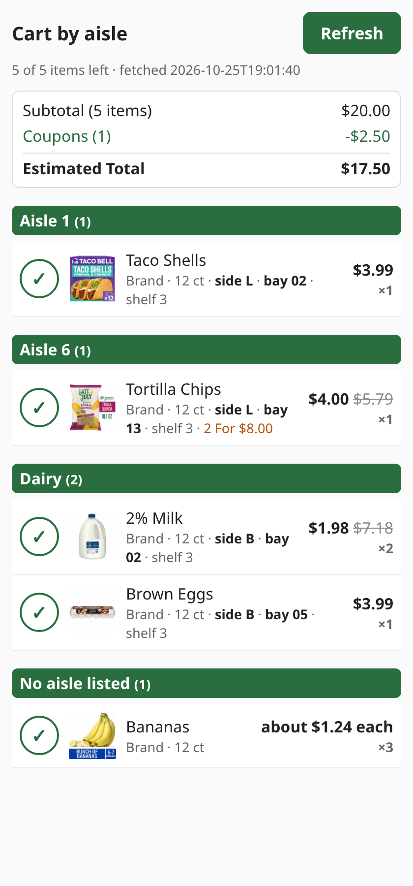

# Harris Teeter cart by aisle

The Harris Teeter app sorts your cart by when you added each item, so walking the store with it
means scrolling up and down the whole list at every aisle. This signs in to harristeeter.com, reads
your cart and shows it on a simple page grouped by aisle, with the same names, sizes, images and
sale prices the app shows. Inside an aisle items are sorted by bay so the list follows you down the
aisle. You can cross things off as you shop.



## How it works

Harris Teeter runs on Kroger's platform and their site sits behind Akamai bot protection, so plain
HTTP requests get blocked. Instead it drives a real (headful) Firefox through
[Camoufox](https://github.com/daijro/camoufox) on a virtual display inside the container. It keeps
one persistent browser profile and one saved fingerprint so it looks like the same returning
shopper every time instead of a new device.

When you press Refresh it

- opens `/signin?redirectUrl=/cart`, which skips straight to the cart if the session is still good
- signs in with your email and password if it isn't
- loads the cart page and saves every JSON response it makes
- closes the browser

The data comes from 3 of those responses. `/atlas/v1/carts` has the cart lines and quantities,
`/atlas/v1/product/v2/products` has the product details and the aisle, side, bay and shelf for
your store, and `/atlas/v1/carts/v2/cart-savings` has each line's price after coupons plus the
subtotal and estimated total. The total matches what the app shows.

Some items (loose produce and some packaged produce) come back with no location at all. The site
doesn't show one for them either, so they go in a "No aisle listed" group at the end. Dairy comes
back as aisle 60 so it sorts after the numbered aisles.

The site is only contacted when you press Refresh. Loading the page just shows the last result.

## Setup

You need Docker. Put your harristeeter.com sign-in in an env file, then run the prebuilt image.

```bash
cp .env.example harris_teeter.env   # fill in HT_EMAIL and HT_PASSWORD
docker run -d --name harris-teeter-cart --restart unless-stopped \
  --env-file harris_teeter.env -e HT_DATA_DIR=/data -e TZ=America/New_York \
  -p 8107:8000 -v "$PWD/data:/data" --shm-size 1g \
  ghcr.io/ljmerza/harris-teeter-cart:latest
```

Or build it yourself with `docker build -t harris-teeter-cart .` and use that tag instead.

Then open `http://<host>:8107` and press Refresh. The first one takes about a minute because it
has to sign in. After that the session is reused.

`--shm-size 1g` matters. Firefox crashes with Docker's default 64 MB of shared memory.

The browser versions are pinned on purpose in the `Dockerfile` (camoufox 0.4.11, playwright
1.61.0 and Camoufox browser 152.0.4-beta.28). An unpinned install pulls whatever is newest and a
mismatched pair breaks every launch. If you bump them, bump them together and do a refresh after.

## Crossing things off

Each item has a ✓ button that removes it from the list. This is only local, nothing is sent to
Harris Teeter. Crossed off items are stored on the server (`data/crossed.json`) so the list is the
same on your phone and computer. Undo brings back the last one, which is handy when you tap the
wrong thing in the middle of an aisle. A successful Refresh clears everything and starts over from
the cart on the site, so it asks first if anything is crossed off.

## Things to know

- This uses Harris Teeter's internal web endpoints, not a public API, so it can break any time
  they change the site.
- Don't put it on a schedule or hammer Refresh. Bursty traffic is what trips Akamai and you'll
  start getting blocked.
- It only handles email and password sign-in. If the site asks for a verification code the
  refresh stops with an error and saves a screenshot to `data/captures/`.
- The page has no auth. Anyone who can reach it can see your cart and press Refresh, so keep it on
  your LAN.
- `data/` holds your browser profile (cookies) and raw captures of your account data. Don't share
  it.
- Other Kroger stores run on the same platform so pointing `HT_BASE_URL` at one (ie
  `https://www.kroger.com`) might work, but I haven't tried it.

## Development

The parser and web page only use the standard library, so the tests run without the browser stack.

```bash
uv sync --group dev
uv run pytest
```

Plain `python3 -m unittest discover -s tests -t .` works too.

Each refresh saves its raw responses, a screenshot and the page HTML to `data/captures/<time>/`
(the last 5 are kept), which is the easiest way to see what changed if the site breaks the parser.
